# VisionForge AI

<p align="center">
  
</p>

<p align="center">
  <strong>Explore the pixels. Understand the patterns. Build the intelligence.</strong>
</p>

<p align="center">
  A Python computer vision project exploring image processing, visual analysis, and AI-powered recognition.
</p>

<p align="center">
  
  
  
  
</p>

---

## The Vision

How can software turn the pixels in an image into useful information?

**VisionForge AI is my journey into Python, computer vision, and practical AI experimentation.**

I'm building this project to strengthen my Python skills and explore how computers process visual information, from basic image transformations to machine-learning-powered recognition.

The goal is to understand the techniques behind the results, test ideas with real inputs, and document what works instead of treating AI as a black box.

## Current Starter

The starter version includes a small Python command-line tool that opens an image and reports its dimensions, color mode, and format. It provides a simple foundation for adding image-processing experiments.

The project does not claim to include trained AI models or object detection yet. Those are future milestones.

## Planned Features

| Feature | Purpose |
|---|---|
| Image inspection | Read image dimensions, format, and color mode |
| Image resizing | Prepare images for downstream processing |
| Color analysis | Explore image colors and basic statistics |
| Edge detection | Identify prominent boundaries in images |
| Image filtering | Experiment with smoothing and transformations |
| Image classification | Explore predictions from a pretrained model |
| Object detection | Investigate locating objects within images |
| Visual reports | Present outputs and experiment results clearly |

Features will be marked complete only after they are implemented and tested.

## Technology Stack

- **Python** for application logic.
- **Pillow** for initial image loading and inspection.
- **OpenCV** for planned computer vision experiments.
- **NumPy** for planned numerical operations.
- **PyTorch** for possible machine-learning experiments.
- **Matplotlib** for planned visualizations.
- **pytest** for tests.

Dependencies will be added when the project needs them.

## Quick Start

### Requirements

- Python 3.10 or newer
- `pip`

### Install

```bash
python -m venv .venv
```

Windows PowerShell:

```powershell
.\.venv\Scripts\Activate.ps1
python -m pip install -r requirements.txt
```

macOS or Linux:

```bash
source .venv/bin/activate
python -m pip install -r requirements.txt
```

### Inspect an image

```bash
python -m visionforge.cli path/to/image.png
```

Replace `path/to/image.png` with the path to an image file on your computer.

## Roadmap

- [x] Create the initial Python package and CLI image-inspection feature.
- [x] Add basic input validation and an example test.
- [ ] Add image resizing.
- [ ] Explore color analysis.
- [ ] Add edge detection with OpenCV.
- [ ] Save example outputs for documentation.
- [ ] Explore a pretrained image-classification model.
- [ ] Evaluate predictions with suitable examples.
- [ ] Investigate object detection as a later extension.

## Project Structure

```text
VisionForge-AI/
├── assets/
│   └── visionforge-banner.svg
├── visionforge/
│   ├── __init__.py
│   ├── image_info.py
│   └── cli.py
├── tests/
│   └── test_image_info.py
├── examples/
├── docs/
├── requirements.txt
├── .gitignore
├── LICENSE
└── README.md
```

## Learning Through Experiments

For each significant experiment, I aim to record the problem, technique, input data, observed results, limitations, and lessons learned.

That process will help me understand not only when a method works, but also where it can fail and how it might be improved.

## Development Principles

- Keep code readable and modular.
- Validate user inputs and handle errors clearly.
- Prefer reproducible experiments.
- Test behavior with suitable examples.
- Document model limitations and avoid overstating accuracy.
- Respect dataset, model, and library licenses.

## About Me

**Mohamed | [@ruhioki](https://github.com/ruhioki)**

I'm an Artificial Intelligence and Data Science student interested in AI engineering, GPU technology, performance optimization, and software development.

VisionForge AI is one step in my journey toward building and explaining practical intelligent systems.

---

<p align="center">
  <strong>VisionForge AI</strong><br/>
  <sub>Explore the pixels. Understand the patterns. Build the intelligence.</sub>
</p>
